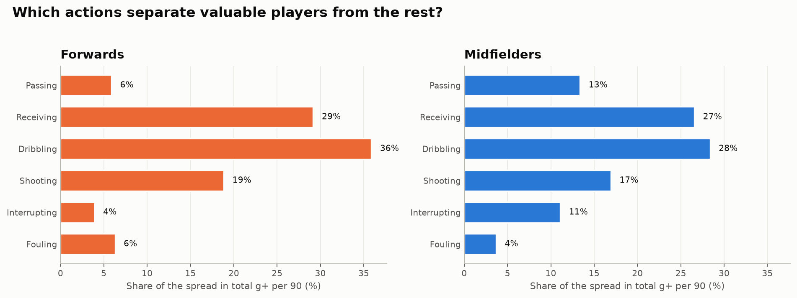
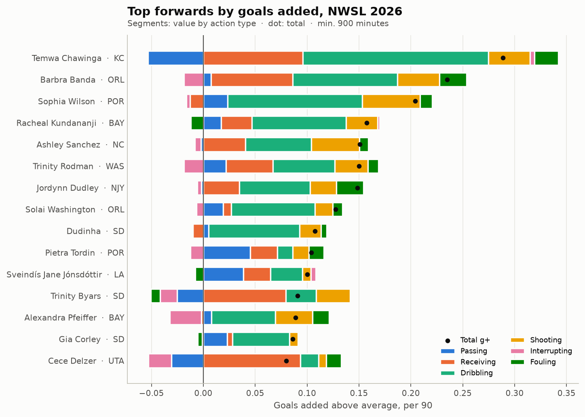
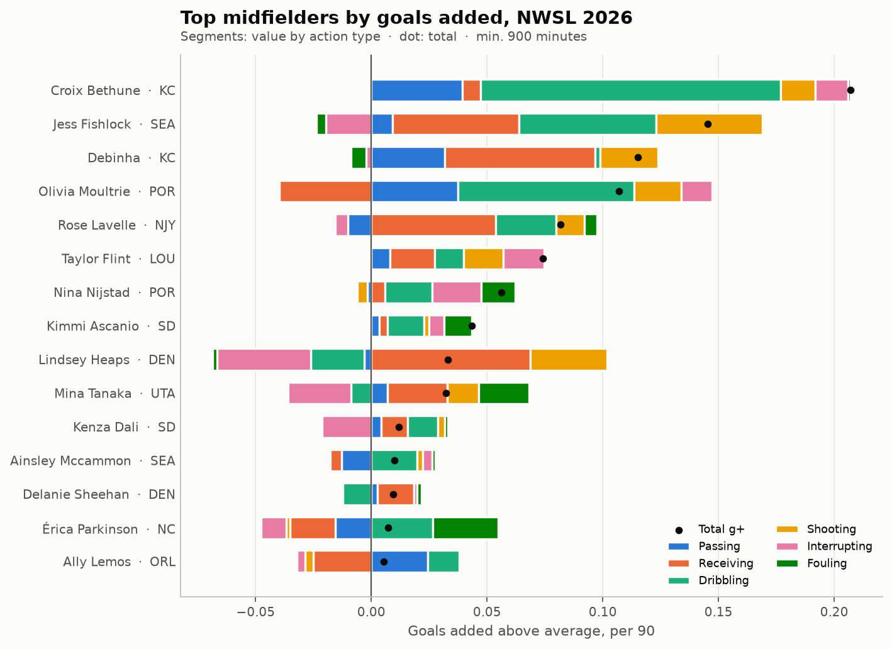
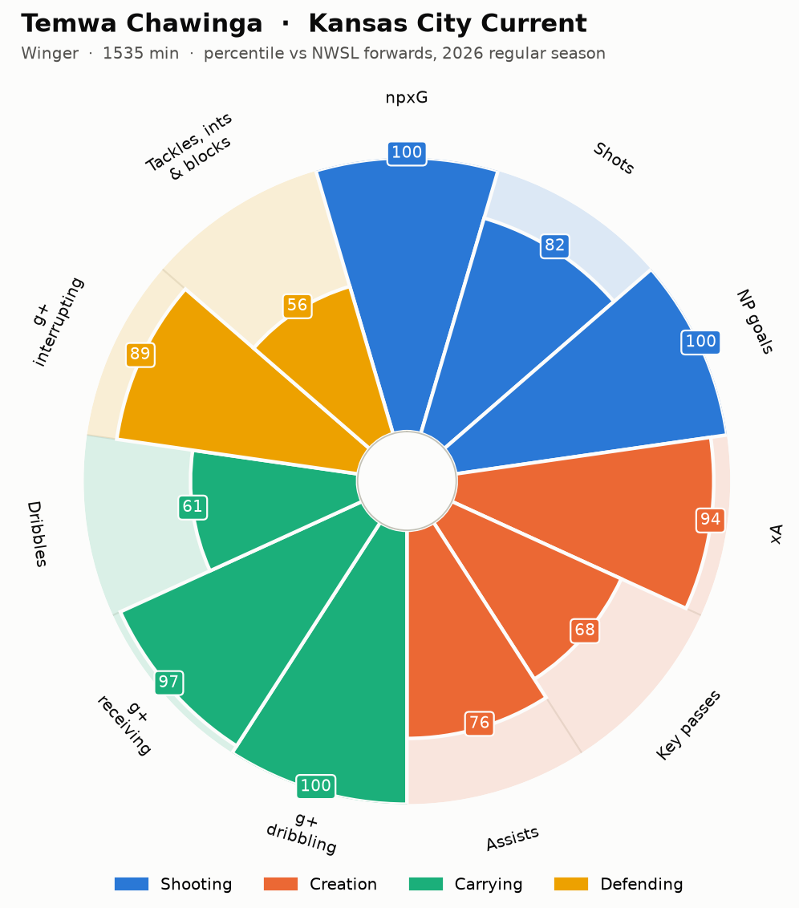
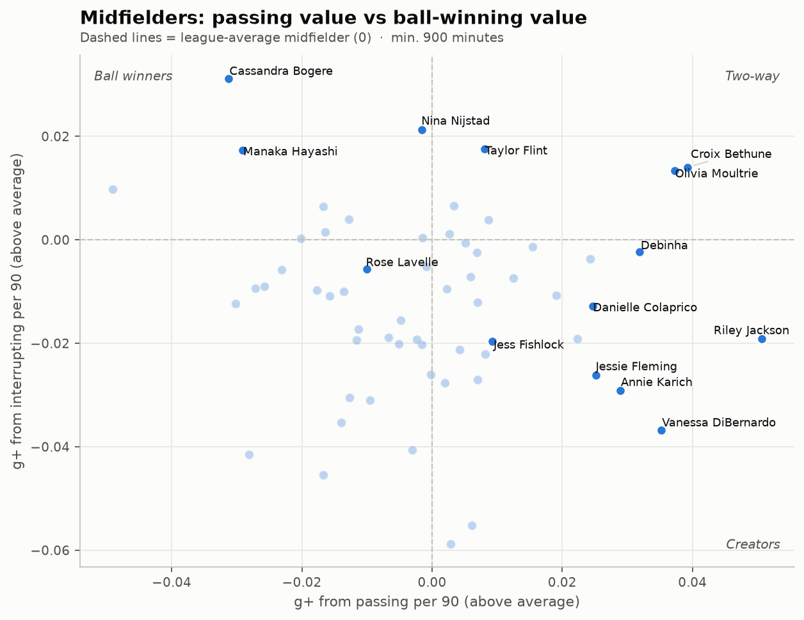
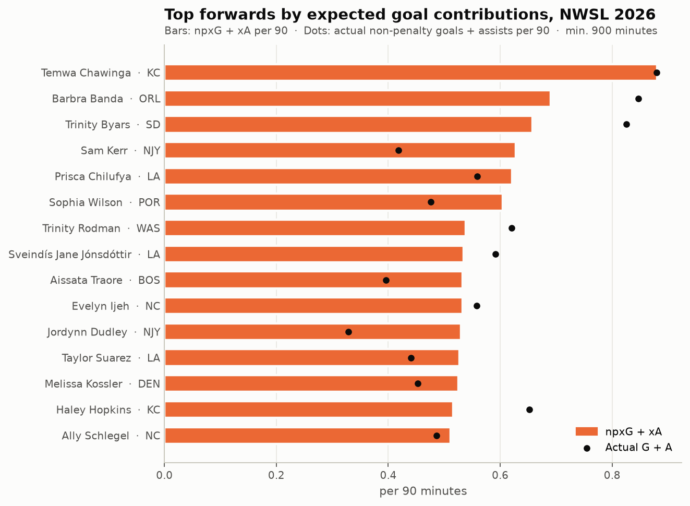
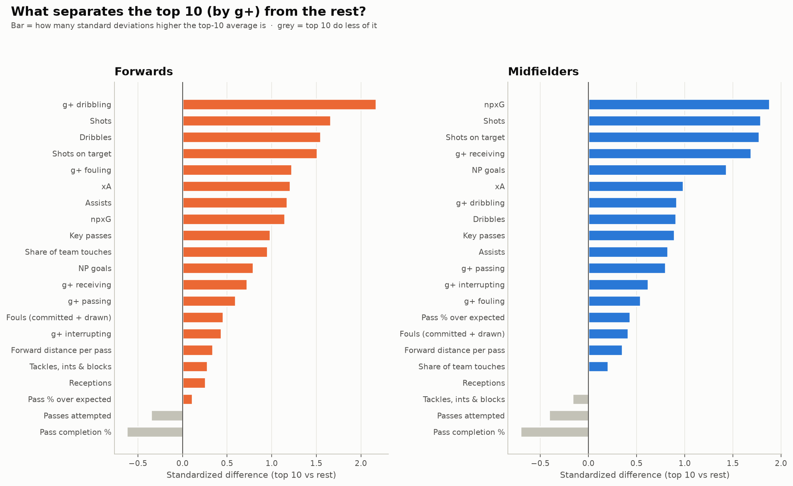

# Who were the best NWSL midfielders and forwards in 2026, and why?

An analysis of the 2026 NWSL regular season (240 games, 16 teams) that ranks midfielders and forwards
and explains *which on-ball actions* make the best players stand out. It covers passing, receiving, dribbling,
shooting, defending (tackles, interceptions, blocks) and fouling, along with xG, goals and assists.

📓 **Main notebook (2026):** [`notebooks/nwsl_2026_best_midfielders_forwards.ipynb`](notebooks/nwsl_2026_best_midfielders_forwards.ipynb)
📓 **Companion (2023, event-level data):** [`notebooks/nwsl_2023_best_midfielders_forwards.ipynb`](notebooks/nwsl_2023_best_midfielders_forwards.ipynb): shot maps, pass maps and a custom expected threat (xT) model



## Key findings (2026)

**Best forwards:** Temwa Chawinga (KC), Barbra Banda (ORL), Sophia Wilson (POR)
- Chawinga ranks #1 by both measures, with 12 non-penalty goals in 1,535 minutes and the highest goals added (g+) per 90 of any qualified player. Banda is #2 on both, with 15 non-penalty goals.

**Best midfielders:** Croix Bethune (KC), Olivia Moultrie (POR), Debinha (KC)
- Bethune had the highest g+ per 90 of any midfielder and 10 assists. Moultrie ranks #1 on the composite as a two-way attacking midfielder who completes harder passes than expected (+4.5 per 100).

**Why they stand out**
1. **Beating defenders and getting on the ball in dangerous spaces drives the gap.** Dribbling and receiving account for 65% of the difference in value between forwards and 55% between midfielders. Passing accounts for only 6% and 13%.
2. **Elite forwards dribble and shoot more:** 17.4 vs 12.6 dribbles and 3.1 vs 2.0 shots per 90.
3. **Elite midfielders arrive in the box.** They take twice as many shots and produce three times the npxG of other midfielders.
4. **Harder passes, completed anyway.** Top midfielders have *lower* raw completion % but *higher* completion over expected.
5. **Defensive volume doesn't separate the elite.** Shots on target is the action most tied to production (r = 0.82 with goals + assists).

The 2023 event-data companion reaches the same conclusion from a different angle: there, carries into the box and progressive carries were the top separators.

| | |
|---|---|
|  |  |
|  |  |
|  |  |

## Data
| Season | Source | What it provides |
|---|---|---|
| 2026 | [American Soccer Analysis](https://app.americansocceranalysis.com/) public API | Player-season xG, xA, shots, key passes, xPass (completion over expected), and **goals added (g+)**: the value of every action, split into passing, receiving, dribbling, shooting, interrupting and fouling, with action counts |
| 2023 | [StatsBomb Open Data](https://github.com/statsbomb/open-data) | Every event with pitch coordinates (~460k events), used for shot maps, pass maps and the xT model |

Free event-level (x/y) data for 2026 isn't published; StatsBomb's open NWSL data covers only 2018 and 2023. That's why the 2026 analysis uses ASA's model outputs.

## Methods (2026)
- **Sample:** regular season only, players with 900+ minutes, grouped by ASA position (midfielders: DM/CM/AM, n = 61; forwards: W/ST, n = 66). Penalties are removed from shots, goals and xG.
- **Ranking:** goals added above average per 90 (ASA's all-in-one value model), cross-checked against a role-specific composite of within-position percentiles with stated weights. The two agree well (Spearman 0.92 forwards, 0.74 midfielders).
- **Why analysis:**
  - *Variance share:* because total g+ is the sum of six action types, cov(action, total) / var(total) splits the player-to-player spread exactly by action type.
  - *Separation:* the standardized difference between the top 10 and the rest on 21 metrics.
  - *Correlation:* Spearman correlation of action rates with actual non-penalty goals + assists per 90.

## Project structure
```
src/load_asa.py      2026 (or any season): ASA API -> data/processed/asa_players_<season>.parquet
src/asa_metrics.py   per-90 table, composite score, variance share, separation
src/load_data.py     2023: StatsBomb events/lineups -> data/processed/*.parquet
src/metrics.py       2023: minutes, xT model, event-level per-player stats
src/plotting.py      shared chart style, labeled scatters, leaderboards, pizza charts
notebooks/           2026 main analysis + 2023 companion
figures/2026, 2023   exported charts
```

## Run it
```bash
python3.12 -m venv .venv && source .venv/bin/activate
pip install -r requirements.txt
python src/load_asa.py 2026      # small, cached in data/raw/asa/
jupyter lab notebooks/nwsl_2026_best_midfielders_forwards.ipynb
```
For the 2023 companion, run `python src/load_data.py` first (downloads ~390 MB of StatsBomb JSON once).
To analyze another season, run `python src/load_asa.py 2025` and set `SEASON = '2025'` in the notebook.

## Limitations
One season; no tracking data (off-ball runs are only credited when they lead to receiving the ball); no adjustment for team strength;
g+ is one model's view of value. Next steps: compare across seasons to see which players hold up, and build a Streamlit player-similarity app.

*Data: American Soccer Analysis (2026) and StatsBomb Open Data (2023).*
